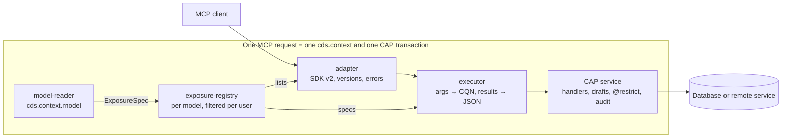

# Architecture

v2 is a thin, stateless adapter in front of CAP. Each MCP request runs in its own
`cds.context`, looks up what this user may see from a cached exposure registry, and turns the
call into CQN sent through the CAP service. The registry is the only place MCP-specific
knowledge lives; everything else is the MCP SDK or CAP.

## Modules

| Module              | Milestone | Responsibility                                                                          | Depends on                                                 | Test style                  |
| ------------------- | --------- | --------------------------------------------------------------------------------------- | ---------------------------------------------------------- | --------------------------- |
| `model-reader`      | M1        | Linked CSN + `@mcp` annotations → `ExposureSpec`; diagnostics for unknown/v1 keys       | CSN; `schema-mapper`'s type table (for `UNSUPPORTED_TYPE`) | Contract (CDS snippets)     |
| `schema-mapper`     | M1        | `FieldSpec` → JSON Schema 2020-12 for inputs and outputs                                | Nothing                                                    | Contract                    |
| `exposure-registry` | M2        | Cache specs per model; build `ToolSpec[]`; hide tools a user can never call             | `model-reader`, a `UserLike`                               | Contract + `cds.test`       |
| `executor`          | M3        | Tool args → CQN objects → `srv.run` / `srv.send`; results and CAP errors → `ToolResult` | A `ServiceLike`                                            | `cds.test` against the demo |
| `adapter`           | M4        | JSON-RPC, protocol versions, auth metadata, HTTP and stdio entry points                 | SDK v2, registry, executor                                 | Behaviour + conformance     |
| `cli`               | M6        | `cds add mcp`, `cds mcp`, build task, startup report                                    | `cds`                                                      | Smoke                       |

The data passed between them is defined in `src/types.ts`.

## Request lifecycle

1. `activate(cds)` mounts one `/mcp` route (all methods) on `served`. A request whose `Origin`
   is neither the app's own nor in `cds.env.mcp.allowedOrigins` gets 403 (DNS rebinding); the
   rest go through `cds.middlewares.before` (ADR 0009). That chain authenticates the request and sets `cds.context` (user, tenant,
   locale, model). Other plugins' middleware (e.g. `@sap/ams`) runs here too, with no special
   code in the plugin. CAP's production default (`restrict_all_services`) lives only in its
   protocol adapters, so `/mcp` applies it itself: with `NODE_ENV=production` and
   `restrict_all_services` not `false`, an anonymous caller gets the login challenge (ADR 0009;
   so `@requires: 'any'` services are not public over MCP in that setting). Then one
   `createMcpHandler(factory)` (ADR 0010), which reads and parses the body itself (no body
   parser in front: malformed or large bodies get JSON-RPC answers).
2. The SDK classifies the request (2026-07-28 envelope or 2025 era), rejects unsupported
   versions, and calls the factory, which builds a fresh `McpServer` with the caller's tools
   (registry for `cds.context.model ?? cds.model`, `toolsFor(cds.context.user)`); the server
   dispatches the JSON-RPC method. Only what the caller can use is advertised, always with
   `listChanged: false`: `tools`, `resources` when some `@mcp.resource` entity is readable
   for them, and `prompts` when a service they can reach has `@mcp.prompts`
   (`registry.promptsFor(user)`; arguments from `promptArgsSchema`, text from `renderPrompt`);
   `tools/list`, `resources/list`, `resources/templates/list`, `prompts/list` and `server/discover` say
   `cacheScope: private` (lists depend on the user) and `ttlMs` 60 s. No session, no `Mcp-Session-Id`.
   2025-era clients get the same tools statelessly: each request (`initialize` included) stands
   alone, answered as SSE; GET and DELETE are 405. They cannot confirm an `@mcp.elicit` call,
   so it is refused with a `CONFIRMATION_REQUIRED` tool error that says why.
   A 2026-07-28 client with the `elicitation` capability confirms through MRTR: the executor
   throws `ConfirmationRequired` (carrying the form, from `elicitationSchema`) before anything
   runs, the adapter answers `input_required`, and the retry's `inputResponses.confirm` becomes
   `execute(…, { confirmed, confirmedArgs })`.
   A 401 (CAP's `next(401)`, e.g. an invalid token) becomes CAP's own login challenge
   (`req._login`, Basic for mocked/basic auth) or, for XSUAA/JWT/IAS,
   `WWW-Authenticate: Bearer resource_metadata="<origin>/.well-known/oauth-protected-resource/mcp"`.
   That RFC 9728 document is public and names the bound authorization server
   (`cds.requires.auth.credentials.url`; the provider's, even for subscriber tenants: see the
   backlog); without one it is 404. URLs follow `X-Forwarded-Proto`/`-Host`. No authorization
   server endpoints, no DCR.
3. `tools/list` → `registry.toolsFor(cds.context.user)` for `cds.context.model`.
4. `tools/call` → the SDK validates args against the tool's input schema →
   `srv.tx(tx => executor.execute(tool, args, tx, user, { confirmed }))` (the service's own root
   transaction, inheriting `cds.context`) →
   `srv.run(cqn)` / `srv.send(...)`. CAP runs handlers, enforces `@restrict`, and commits or
   rolls back. `execute` throws on any error, so CAP rolls back; only then does the adapter
   translate it as CAP's protocol adapters do (`cds.i18n.messages`, the caller's locale, the
   error's `args`) and turn it into a tool result with `errorResult(error)` (bad arguments, CAP 4xx) or report it as an
   error (failed commits, bugs).
5. The result goes back as `structuredContent` plus one text block, or as a tool error that
   keeps CAP's `code`, `target` and `details`.

`resources/read` of `cap://<Service>/<Entity>/<key>` (ADR 0006) takes the same path as a `get`
call: `registry.resourcesFor(user)` gives the templates (one per readable `@mcp.resource`
entity, no record lists), `executor.readResource(entity, key, tx)` runs in `srv.tx`, and the
record comes back as one `application/json` content. The key segment is the one tool results
link to: the value of a single key, or `k1=v1;k2=v2`, URI-encoded. A missing record or a key that
is not one is the protocol's resource-not-found error (`-32602` with the `uri`).

A resource whose single key has `@mcp.completion` (`ResourceSpec.completion`) gets a
`complete.key` callback on its template: `executor.completeKey(entity, value, tx)` runs a
`startswith` SELECT of the key in `srv.tx`, and the SDK answers `completion/complete` (and
advertises `completions`) from it.

MCP App UIs (`@mcp.ui`, ADR 0012) are plain resources, registered per request by the adapter
(`adapter/apps.ts`): `activate()` reads `app/mcp-apps/<path>` for each linked `ui://` URI once
CAP has served the app, then emits `mcp:apps` so app code can register more. Per request, a tool
keeps its UI link only if the resource has content, and the caller can list and read exactly the
UIs their tools link to. No dependency on `@modelcontextprotocol/ext-apps` at runtime.

## Describe tools and access

Describe tools (`<Service>_describe`, compact `list_entities` / `describe_entity`) never call CAP:
they describe the spec, scoped by `exposure-registry/access.ts`, the plugin's copy of CAP's
`@requires` / `@restrict` role rules (the same rules that hide tools). That is advertising, as
CAP's `$metadata` is; if the copy ever drifts from CAP, metadata could over- or under-share, so
changes to CAP's auth rules must be mirrored there with a test.

## Tool names

`<Service>_<Entity>_<mode>` and `<Service>_<operation>`, using the service's short name (its
namespace is dropped) and `_` for dots in local names, so names fit `[a-zA-Z0-9_-]` that many LLM
tool APIs require. Names must match MCP's `[A-Za-z0-9._-]{1,128}` (`INVALID_TOOL_NAME`); over 64
characters is a `LONG_TOOL_NAME` warning; equal names clash (`TOOL_NAME_CLASH`), and the plugin's
own tools win over model tools. Sorted by code point.

## Tool input shapes

Built by `schema-mapper`, executed by `executor`. Every argument is structured JSON, so the
executor builds CQN objects and the agent can only name exposed fields (the field names are
JSON Schema enums). `additionalProperties` is always `false`, except for the open `key`/`data`/`args`
objects of compact tools, which the executor checks against the target's own schema.

| Tool        | Arguments                                                                                                                                  |
| ----------- | ------------------------------------------------------------------------------------------------------------------------------------------ |
| query       | `q`, `where: [{ field, op, value }]` (all must hold), `orderby: [{ field, dir }]`, `select: [field]`, `top` (≤ `limits.maxRows`), `cursor` |
| get, delete | The keys, all required                                                                                                                     |
| create      | Writable fields; `@mandatory` / `not null` ones required; `@mcp.deepInsert` compositions nested (array for many, object for one)           |
| update      | Keys (required) plus any writable field, and the same nested compositions as create                                                        |
| operation   | Parameters (mandatory ones required); bound operations also take their entity's keys                                                       |

A `@mcp.describe` service adds `<Service>_describe` (`entity?`, limited to that service's
entities). A `@mcp.compact` service publishes `<Service>_list_entities`, `_describe_entity`,
`_query`, `_get`, `_create`, `_update`, `_delete` and `_call_operation` instead of per-entity and
per-operation tools; each names its target in an `entity` (or `operation`) enum of what it can act
on, write tools only appear when some entity allows them, and field-level shapes come from
`describe_entity` (the executor validates against the entity's own schemas). `@mcp.ui` operations
keep their own tool, with `_meta.ui.resourceUri` and the deprecated `_meta["ui/resourceUri"]`.

`op` is one of `eq ne gt ge lt le in contains startswith endswith`. Readonly fields never appear in
write inputs; in a deep insert, the child's back link to its parent (from the composition's
`on` condition) is left to CAP, and a to-one composition's foreign key is replaced by the nested
object. A self-composition nests one level.

## Tool output shapes

`structuredContent` is always an object: query → `{ rows, total, nextCursor? }`; get, create and
update → the record; operations → `{ value }` (a scalar, a list, or one record that may be
`null`); delete and operations without a return type → no output schema. 2026-07-28 allows any
JSON here; objects keep one shape per tool kind and work for 2025-era clients too. Values are as
CAP returns them (Decimal and Int64 as strings). Only keys and `not null` fields are non-null:
`@mandatory` is checked on input, so stored rows can still hold null. Omitted fields are never
in an output schema, including in records an operation returns.

## Division of labour

| Concern        | CAP does it                                  | The plugin does it                                                                                                                                                                                                                                                                |
| -------------- | -------------------------------------------- | --------------------------------------------------------------------------------------------------------------------------------------------------------------------------------------------------------------------------------------------------------------------------------- |
| Authentication | ✔ (auth strategies, AMS)                     | Serves RFC 9728 metadata so clients can find the authorization server                                                                                                                                                                                                             |
| Authorization  | ✔ (`@requires`, `@restrict`, instance rules) | Hides tools CAP would always refuse: `@requires` (service, entity, operation) and the roles of `@restrict` grants, as CAP evaluates them; `where` only filters rows, so it never hides a tool. Describe and compact tools only name what the user can reach. Never decides access |
| Transactions   | ✔ (one per request, commit/rollback)         | Never opens, commits or swallows                                                                                                                                                                                                                                                  |
| Validation     | ✔ (`@mandatory`, `@assert.*`, handlers)      | JSON Schema for the agent's benefit only                                                                                                                                                                                                                                          |
| Search         | ✔ (`SELECT.search`, `@cds.search`)           | Passes `q` with explicit columns: CAP's `@cds.search` rules minus `@mcp.omit`                                                                                                                                                                                                     |
| Drafts         | ✔ (draft API)                                | Drives NEW → SAVE (create) and EDIT → patch → SAVE (update) for draft roots                                                                                                                                                                                                       |
| Exposure       |                                              | ✔ (`@mcp*` annotations, opt-in)                                                                                                                                                                                                                                                   |
| Protocol       |                                              | ✔ (SDK v2)                                                                                                                                                                                                                                                                        |

## What lives where at runtime

- No module reads `global.cds` (ADR 0005). `activate(cds)` receives it from `cds-plugin.js`.
- Under Jest, `cds-plugin.js` loads `src/` through ts-jest; elsewhere it loads `lib/`.
- The registry caches per model object, so extended tenant models (multitenancy, P1) get their
  own tool lists without extra code.
