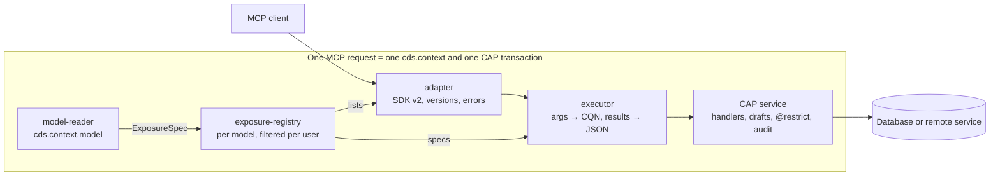

# Architecture

v2 is a thin, stateless adapter in front of CAP. Each MCP request runs in its own
`cds.context`, looks up what this user may see from a cached exposure registry, and turns the
call into CQN sent through the CAP service. The registry is the only place MCP-specific
knowledge lives; everything else is the MCP SDK or CAP.

## Modules

| Module              | Milestone | Responsibility                                                                          | Depends on                   | Test style                  |
| ------------------- | --------- | --------------------------------------------------------------------------------------- | ---------------------------- | --------------------------- |
| `model-reader`      | M1        | Linked CSN + `@mcp` annotations → `ExposureSpec`; diagnostics for unknown/v1 keys       | CSN only                     | Contract (CDS snippets)     |
| `schema-mapper`     | M1        | `FieldSpec` → JSON Schema 2020-12 for inputs and outputs                                | Nothing                      | Contract                    |
| `exposure-registry` | M2        | Cache specs per model; build `ToolSpec[]`; hide tools a user can never call             | `model-reader`, a `UserLike` | Contract + `cds.test`       |
| `executor`          | M3        | Tool args → CQN objects → `srv.run` / `srv.send`; results and CAP errors → `ToolResult` | A `ServiceLike`              | `cds.test` against the demo |
| `adapter`           | M4        | JSON-RPC, protocol versions, auth metadata, HTTP and stdio entry points                 | SDK v2, registry, executor   | Behaviour + conformance     |
| `cli`               | M6        | `cds add mcp`, `cds mcp`, build task, startup report                                    | `cds`                        | Smoke                       |

The data passed between them is defined in `src/types.ts`.

## Request lifecycle (target, M4)

1. CAP's middleware chain authenticates the request and sets `cds.context` (user, tenant,
   locale). Other plugins' middleware (e.g. `@sap/ams`) runs here too, with no special code in
   the plugin. How we mount inside that chain is the M4 spike (ADR 0002).
2. The adapter reads the protocol version from `_meta`, rejects unsupported versions, and
   dispatches the JSON-RPC method.
3. `tools/list` → `registry.toolsFor(cds.context.user)` for `cds.context.model`.
4. `tools/call` → validate args against the tool's input schema →
   `executor.execute(tool, args, srv)` → `srv.run(cqn)` / `srv.send(...)`. CAP runs handlers,
   enforces `@restrict`, and commits or rolls back.
5. The result goes back as `structuredContent` plus one text block, or as a tool error that
   keeps CAP's `code`, `target` and `details`.

## Tool input shapes

Built by `schema-mapper`, executed by `executor`. Every argument is structured JSON, so the
executor builds CQN objects and the agent can only name exposed fields (the field names are
JSON Schema enums). `additionalProperties` is always `false`.

| Tool        | Arguments                                                                                                                                  |
| ----------- | ------------------------------------------------------------------------------------------------------------------------------------------ |
| query       | `q`, `where: [{ field, op, value }]` (all must hold), `orderby: [{ field, dir }]`, `select: [field]`, `top` (≤ `limits.maxRows`), `cursor` |
| get, delete | The keys, all required                                                                                                                     |
| create      | Writable fields; `@mandatory` / `not null` ones required; `@mcp.deepInsert` compositions as arrays of the child's create shape             |
| update      | Keys (required) plus any writable field                                                                                                    |
| operation   | Parameters (mandatory ones required); bound operations also take their entity's keys                                                       |

`op` is one of `eq ne gt ge lt le in contains startswith endswith`. Readonly fields never appear in
write inputs; in a deep insert, the child's back link to its parent is left to CAP.

## Division of labour

| Concern        | CAP does it                                  | The plugin does it                                                    |
| -------------- | -------------------------------------------- | --------------------------------------------------------------------- |
| Authentication | ✔ (auth strategies, AMS)                     | Serves RFC 9728 metadata so clients can find the authorization server |
| Authorization  | ✔ (`@requires`, `@restrict`, instance rules) | Hides tools a user can never call; never decides access               |
| Transactions   | ✔ (one per request, commit/rollback)         | Never opens, commits or swallows                                      |
| Validation     | ✔ (`@mandatory`, `@assert.*`, handlers)      | JSON Schema for the agent's benefit only                              |
| Search         | ✔ (`SELECT.search`, `@cds.search`)           | Passes `q` through                                                    |
| Drafts         | ✔ (draft API)                                | Chooses NEW/EDIT/SAVE for draft-enabled entities                      |
| Exposure       |                                              | ✔ (`@mcp*` annotations, opt-in)                                       |
| Protocol       |                                              | ✔ (SDK v2)                                                            |

## What lives where at runtime

- No module reads `global.cds` (ADR 0005). `activate(cds)` receives it from `cds-plugin.js`.
- Under Jest, `cds-plugin.js` loads `src/` through ts-jest; elsewhere it loads `lib/`.
- The registry caches per model object, so extended tenant models (multitenancy, P1) get their
  own tool lists without extra code.
